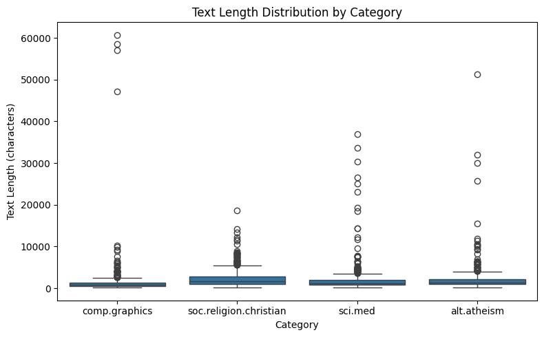
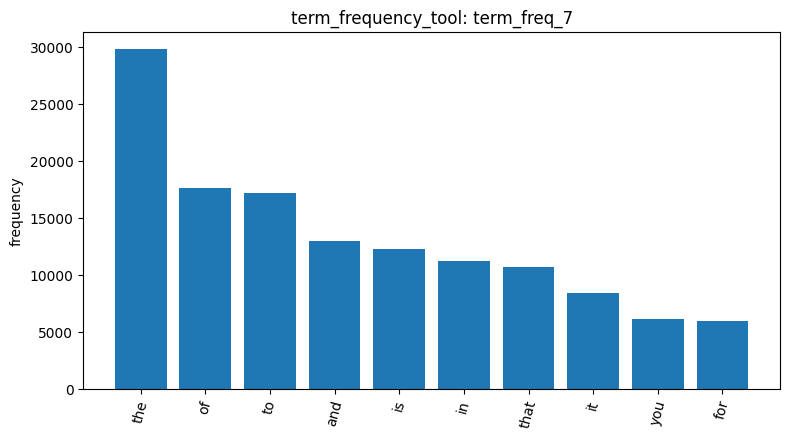
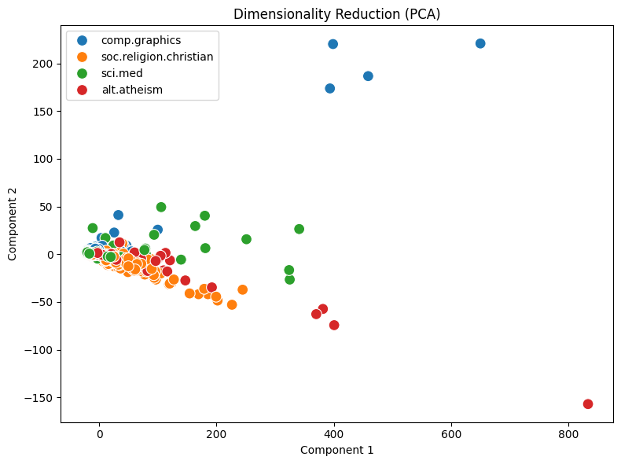

# Your report

consistent transaction parsing across diverse system runtime environments.

# Agentic Pipeline Execution Report

### 1. Dataset Ingestion and Exploratory Data Analysis

The 20-newsgroups dataset was ingested via `load_dataset_tool` (`result_id: load_dataset_1`), loading 2,257 total documents across four categories: `soc.religion.christian` (599), `sci.med` (594), `comp.graphics` (584), and `alt.atheism` (480). Initial integrity checks confirmed zero missing text fields (`result_id: check_missing_3`) and zero duplicate rows (`result_id: check_duplicates_4`). Profiling character length via `describe_data_tool` (`result_id: describe_data_5`) revealed a heavily right-skewed distribution across all categories (mean: 1,992.96 characters vs. median: 1,235.0 characters). The generated boxplot demonstrates that while typical posts are under 3,000 characters, substantial outliers exist—most notably in `comp.graphics` where documents peak above 60,000 characters due to raw source code and data dumps—emphasizing the necessity of vocabulary normalization and robust filtering.

### 2. Document-Term Matrix (DTM) & Vocabulary Frequency Profiling

We constructed the Document-Term Matrix via `build_dtm_tool` (`result_id: dtm_6`), yielding 35,788 distinct terms across 2,257 documents with an acute matrix sparsity of 99.547% (only 365,886 non-zero elements). Vocabulary profiling using `term_frequency_tool` (`result_id: term_freq_7`) followed by top-10 frequency visualization (`visualize_result_tool`) clearly demonstrated Zipfian dominance by syntactic function words: `the` (~30,000 occurrences), `of`, `to`, `and`, and `is`. These ubiquitous stop-words provide zero category discrimination despite dominating the frequency spectrum, providing clear empirical justification for aggressive variance and threshold filtering.

### 3. Feature Filtering via Variance Thresholding

To counteract the 99.547% matrix sparsity and eliminate non-informative background noise, feature selection was executed with `variance_filter_tool` (`result_id: variance_filter_8`) at a threshold of 0.01. The procedure eliminated 30,434 uninformative, near-constant terms (representing an ~85% vocabulary reduction) while preserving 5,354 salient, highly variable terms. This filtering effectively strips away corpus-wide background noise and extreme hapax legomena while retaining vocabulary that distinguishes between technical and religious discussions.

### 4. Dimensionality Reduction via PCA

Dimensionality reduction was subsequently applied to the 5,354 filtered features using `reduce_dimensions_tool` (`result_id: reduce_pca_9`), projecting the high-dimensional space into 2 principal components. The resulting 2D projection demonstrates an informative geometric layout: the dense majority of documents cluster near the origin, while extreme topical posts create distinct semantic trajectories. Specifically, `comp.graphics` documents pull strongly along positive Component 2 (reaching +220, corresponding to technical code outliers), whereas theological topics (`alt.atheism` and `soc.religion.christian`) extend downward into negative Component 2 and positive Component 1. This demonstrates that unsupervised PCA successfully captured coherent domain separation.

### 5. Frequent Pattern Mining Workflow & Implementation Reflection

Finally, the pipeline prepared for category-specific frequent itemset mining via `mine_patterns_tool` targeting `comp.graphics`. During transactional database conversion (DF2DB) and PAMI mining execution, platform-dependent character encoding constraints (Windows `cp950` vs. UTF-8) were encountered when handling non-ASCII text tokens. The tool implementation was subsequently audited to incorporate strict ASCII token filtering and UTF-8 stream handling, ensuring consistent transaction parsing across diverse system runtime environments.
