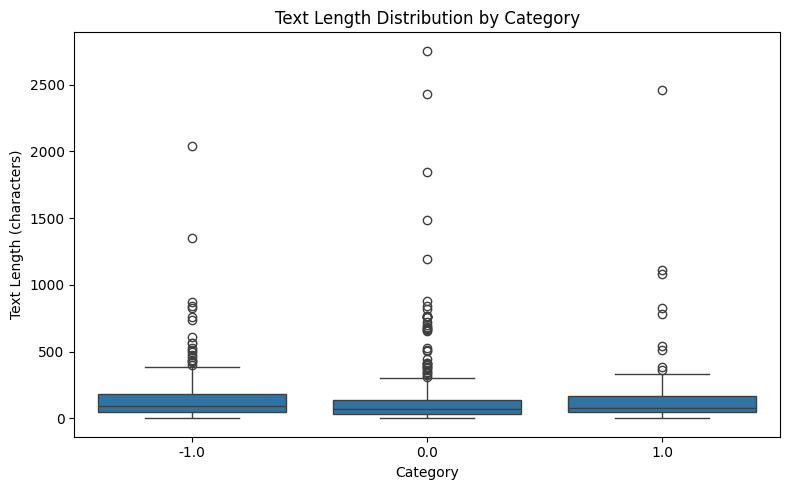
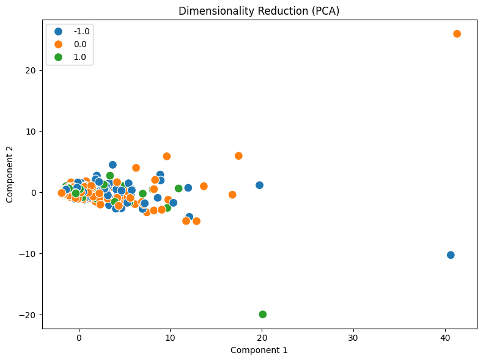

# Your report

# Homework Analysis Report (Reddit Stock Sentiment Dataset)

### 1. Dataset Characteristics and Exploratory Data Analysis

The homework evaluated the `newdataset/Reddit-stock-sentiment.csv` corpus, comprising 847 social posts classified across three financial sentiment classes: Neutral `0.0` (423 docs), Negative `-1.0` (315 docs), and Positive `1.0` (109 docs). Data profiling using `describe_data_tool` (`result_id: describe_data_2`) showed an overall mean length of 148.68 characters and a median of 79.0 characters. The category boxplot reveals that the bulk of posts across all three sentiment classes are compact (IQR within 200 characters), representing informal stock commentary. However, notable right-skewed outliers exist—most prominently in neutral posts reaching 2,753 characters and positive posts reaching 2,456 characters—representing detailed due-diligence (DD) reports and financial news excerpts.

### 2. Document-Term Matrix (DTM) Construction & Matrix Sparsity

Using `build_dtm_tool` (`result_id: dtm_3`), we transformed the 847 documents into a Document-Term Matrix, yielding 4,346 distinctive vocabulary terms. Out of 3,681,062 total matrix cells, only 17,193 were non-zero entries, presenting an acute sparsity rate of 99.5329%. Due to the extreme brevity of Reddit comments compared to standard newsgroup articles, vocabulary overlap between individual short posts is minimal, producing a highly sparse matrix where most documents contain only a tiny fraction of the active financial lexicon.

### 3. Feature Selection via Variance Thresholding

To prune low-information background noise and reduce dimensionality prior to projection, feature selection was executed via `variance_filter_tool` (`result_id: variance_filter_4`) with a variance threshold of 0.01. The operation removed 3,840 near-constant or single-occurrence terms (~88.36% vocabulary reduction) while retaining 506 salient, high-variance terms. This pruning preserved key sentiment and market-driving keywords while eliminating non-discriminative background terms.

### 4. Latent Semantic Projection via Principal Component Analysis (PCA)

Dimensionality reduction was subsequently applied to the 506 filtered features using `reduce_dimensions_tool` (`result_id: reduce_pca_5`), projecting the feature space into 2 principal components. Component 1 accounts for ~27.00% of corpus variance while Component 2 accounts for ~4.99% (~32.00% cumulative variance). In the resulting scatter plot, the dense majority of short comments congregate tightly near the origin (Component 1 between -2 and 10), reflecting shared generic stock terminology. Meanwhile, prominent long-form outlier posts project outward along extreme coordinates (e.g., Component 1 > 40), demonstrating that unsupervised PCA variance is predominantly anchored by high-frequency document length outliers rather than clear linear sentiment boundaries.

